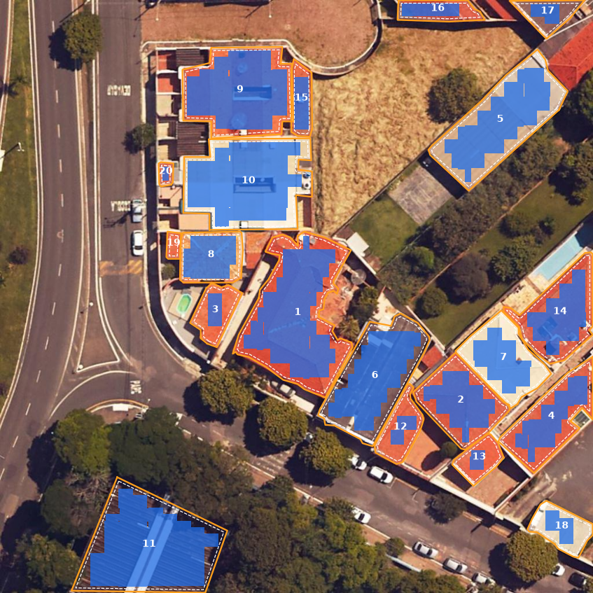
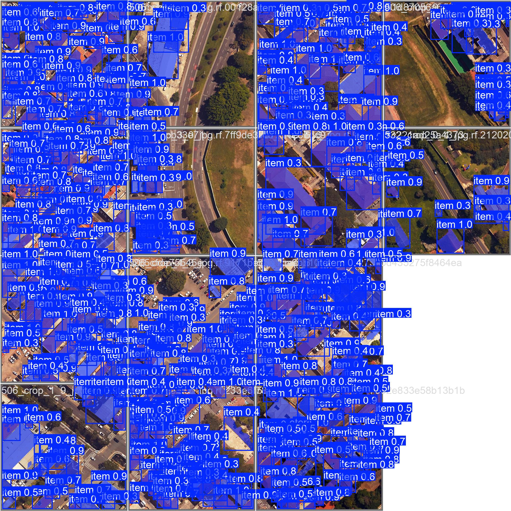
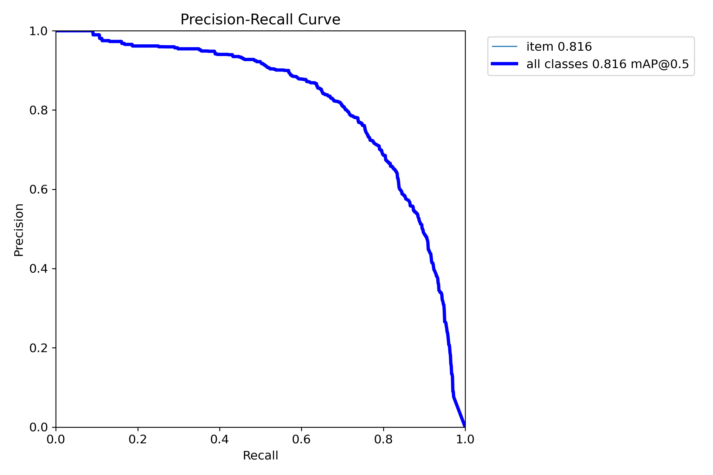

# Potencial fotovoltaico de telhados com YOLO11

Este projeto estima **quantos painéis solares cabem em cada telhado de uma cidade, e quanta energia eles gerariam**, usando apenas imagens de satélite 2D. Ele não precisa de LiDAR nem de levantamento em campo.

O pipeline segmenta os telhados com um **YOLO11 de segmentação de instâncias** treinado em um dataset anotado à mão. Em seguida, simula o encaixe de módulos fotovoltaicos reais na área útil de cada telhado e calcula a geração anual.

> *English:* rooftop solar potential estimation from satellite imagery. YOLO11 instance segmentation (mask mAP@50 = 0.82) + geometric packing of real PV modules with Shapely + annual yield estimate. Case study: Itu-SP, Brazil.

<p align="center">
  
  <br><sub>Contorno do telhado (laranja), área útil após o recuo de 0,5 m (tracejado) e módulos encaixados (azul).</sub>
</p>

## Como funciona

```
ortofoto (.tif) ─► recortes 1024×1024 ─► YOLO11n-seg ─► polígonos dos telhados
                                                           │
             geração anual (kWh) ◄─ melhor orientação ◄─ encaixe de módulos na área útil
```

1. **Recortes** (`tiling.py`): divide as ortofotos (~0,1 m/pixel) em blocos de 1024 px.
2. **Segmentação** (`segmentation.py`): o YOLO11n-seg devolve um polígono por telhado, em pixels.
3. **Área útil** (`panels.py`): converte o polígono para metros e aplica um recuo de 0,5 m nas bordas (buffer negativo).
4. **Encaixe de painéis** (`panels.py`): percorre a área útil em grade, com pequenos deslocamentos para aproveitar cantos irregulares. Testa os módulos rotacionados em 0°, 45°, 90° e 135° e fica com a orientação que comporta mais módulos.
5. **Geração** (`energy.py`): `E = N × P_módulo × H × PR × 365`. Os parâmetros são um módulo de 560 Wp (2,465 × 1,134 m), irradiação média de 5,094 kWh/m²/dia e performance ratio de 0,8.

Contar os módulos que **de fato cabem** no telhado dá uma estimativa mais realista do que multiplicar a área total por uma densidade média de potência.

## Resultados

### Segmentação (conjunto de validação, melhor época)

| Métrica (máscara) | Valor |
|---|---|
| mAP@50 | **0,822** |
| mAP@50-95 | 0,563 |
| Precisão | 0,778 |
| Recall | 0,737 |

<p align="center">
  
  
</p>

Também estão em [`results/`](results): curvas de treino, matriz de confusão, `args.yaml` e `results.csv` de todas as épocas.

### Potencial fotovoltaico
As estimativas de geração ficaram a **menos de 10%** das simulações de referência feitas no **PVWatts** (NREL) para os mesmos telhados.

## Dataset

- 188 imagens de 1024×1024 px (133 de treino, 37 de validação e 18 de teste), com 20 a 40 telhados por imagem, **anotadas à mão** com polígonos no Roboflow.
- Ortofotos cedidas pela **Prefeitura de Itu-SP** para fins acadêmicos.
- Disponível no Roboflow Universe (CC BY 4.0): [telhados-tcc v6](https://universe.roboflow.com/telhado-mtuzc/telhados-tcc/dataset/6).
- As anotações separam telhados *inclinados* e *retos*. O modelo final foi treinado com classe única (`single_cls=True`).

## Treinamento

| Parâmetro | Valor |
|---|---|
| Modelo base | `yolo11n-seg.pt` (pré-treinado no COCO) |
| Tamanho da imagem | 1024 |
| Épocas | 50 (early stopping com patience 8) |
| Batch | automático (`batch=-1`) |
| Ambiente | Google Colab (GPU) |

Os pesos treinados (`best.pt`, 6 MB) estão na [página de releases](../../releases).

## Como usar

```bash
pip install -e ".[model]"     # sem [model] se for usar só a parte geométrica

# com o modelo treinado
python -m solar_rooftops.pipeline examples/telhados_itu.jpg --weights best.pt

# sem o modelo, a partir dos polígonos anotados (formato YOLO)
python -m solar_rooftops.pipeline examples/telhados_itu.jpg --labels examples/telhados_itu.txt
```

A saída é `output/telhados.csv` (área, área útil, nº de painéis, orientação e kWh/ano por telhado) e `output/layout.png`.

Para retreinar a partir do dataset do Roboflow:
```bash
python scripts/train.py --data caminho/para/data.yaml
```

Testes da lógica de encaixe e de geração:
```bash
pip install -e ".[dev]" && pytest
```

## Estrutura

```
src/solar_rooftops/   pacote: recortes, segmentação, encaixe de painéis, geração e pipeline (CLI)
scripts/train.py      reprodução do treinamento
notebooks/            notebooks originais do Colab (exploração e experimentos)
results/              métricas e gráficos do treinamento
examples/             imagem de exemplo, anotação e resultado do pipeline
tests/                testes unitários
```

## Limitações e próximos passos
- O cálculo assume telhado plano: inclinação e orientação (azimute) das águas ainda não entram na conta.
- Não há modelagem de sombreamento de árvores e prédios vizinhos.
- A validação foi feita só em Itu. Testar em outras cidades mostraria se o método generaliza.

## Autores
Trabalho de Conclusão de Curso, Bacharelado em Ciência da Computação, **IFSP – Campus Salto** (2025).

- **Eduardo Minghini Sales da Silva** · [GitHub](https://github.com/3duzera) · [LinkedIn](https://www.linkedin.com/in/eduardo-minghini-sales-da-silva-84b409205/)
- **Victor Augusto Sampaio Precoma**
- Orientador: **Prof. Dr. Claudio Haruo Yamamoto**

O código está sob licença MIT ([`LICENSE`](LICENSE)). O dataset está sob licença CC BY 4.0.
